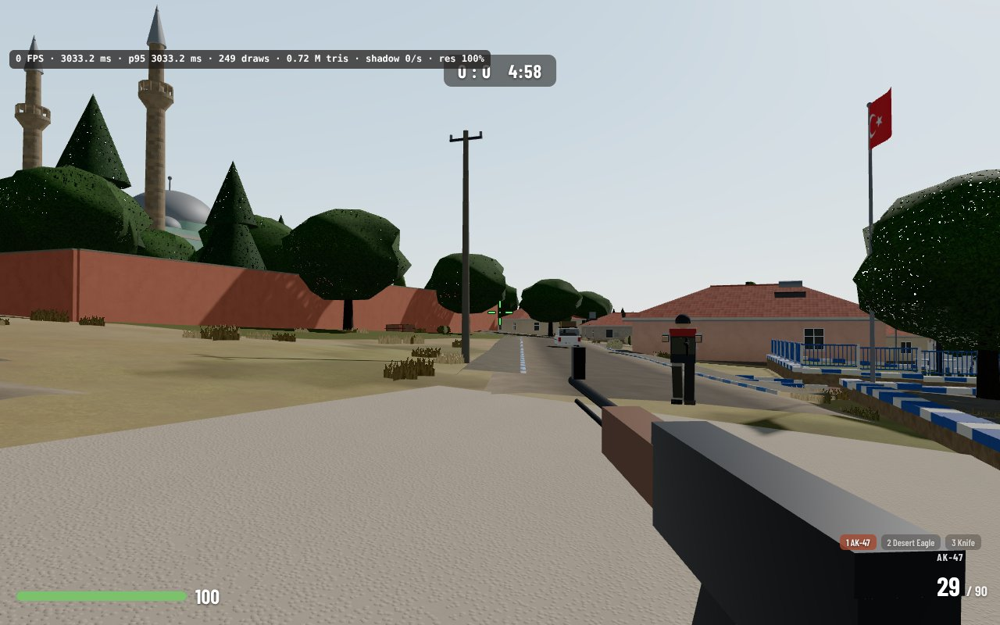
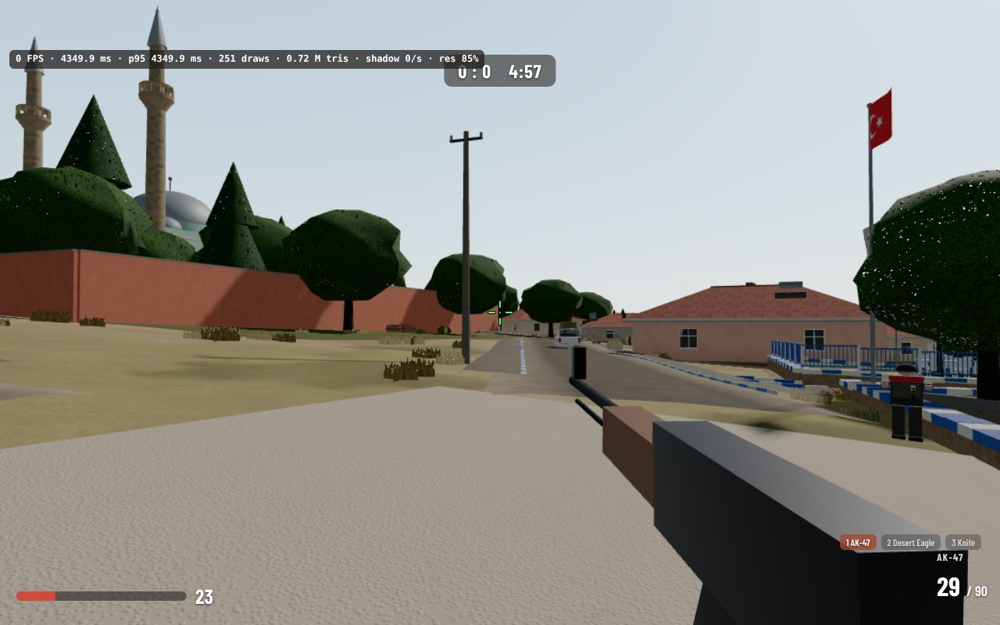
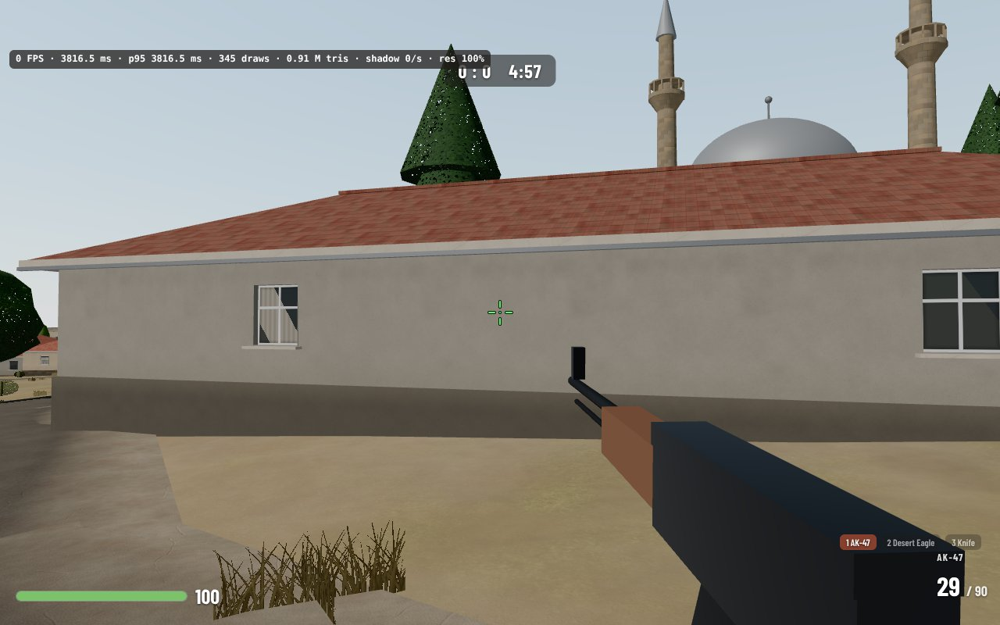
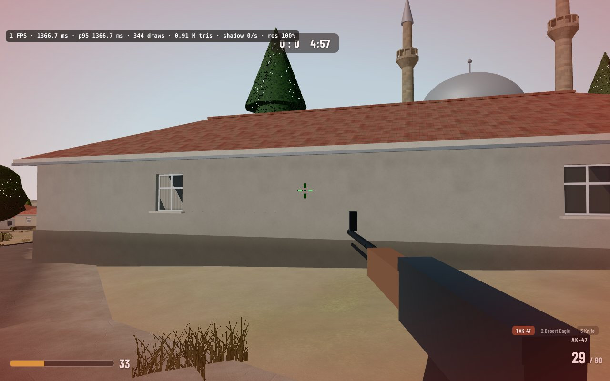
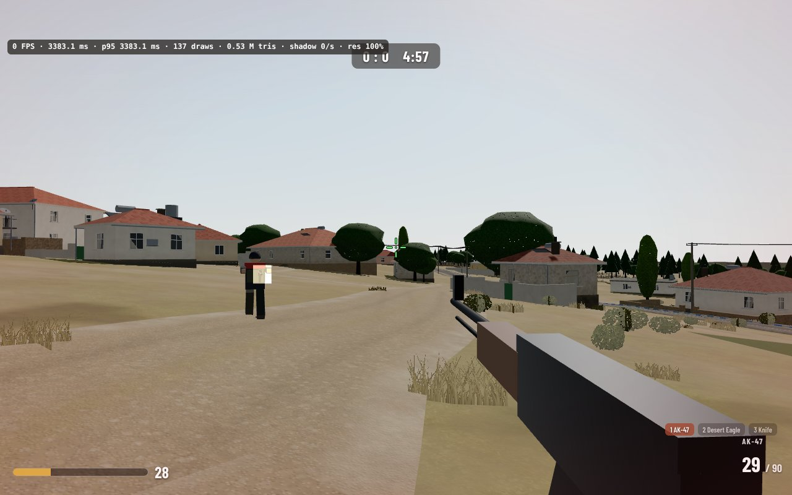
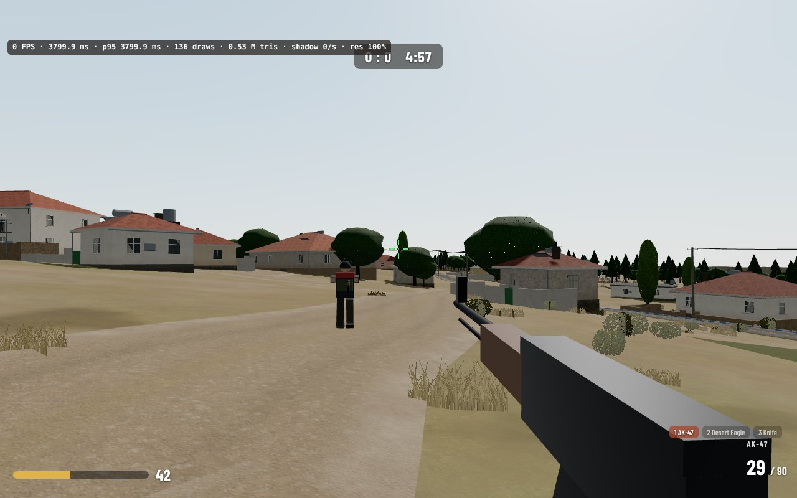
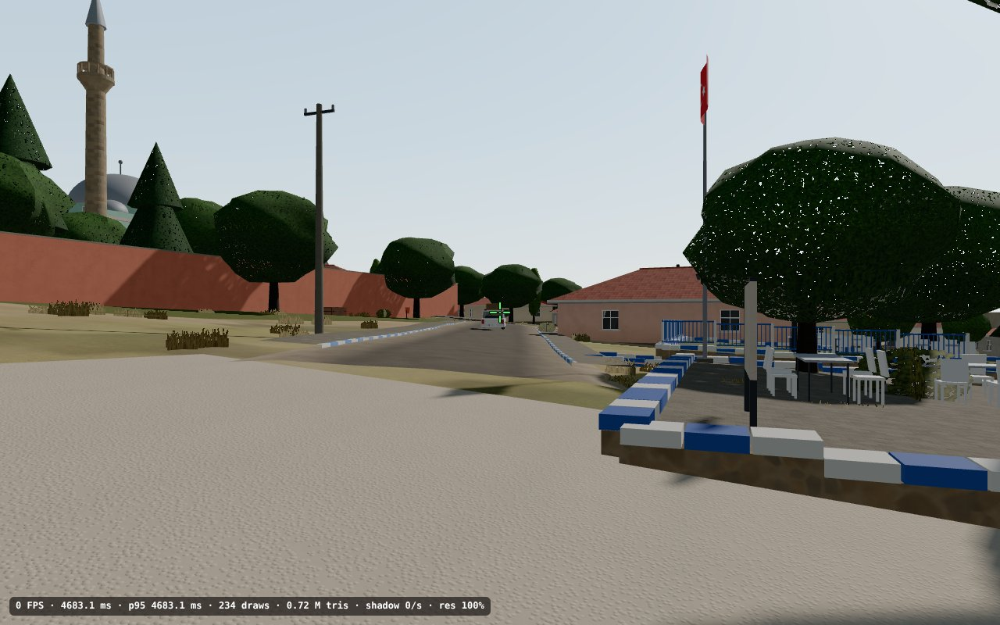
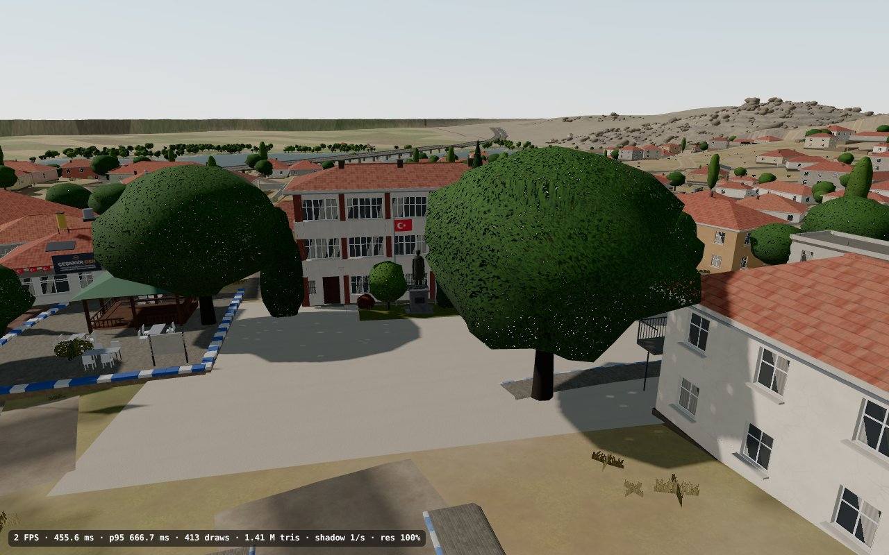
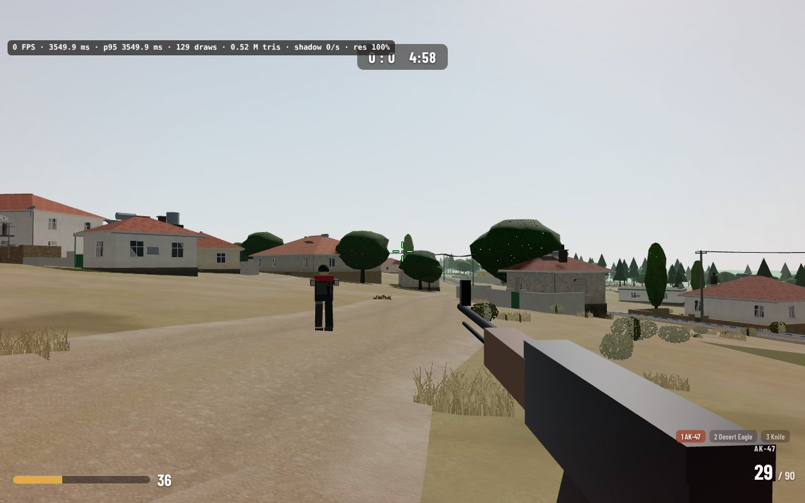

# Game mode performance (v1.1, Nov 2026)

What makes the Game mode stutter, what was changed about it, and what each change bought. Everything here is
measured with the benchmark that ships with the site; nothing is estimated.

## How it is measured

**The benchmark.** Open the site with `#bench=50` (any number of bots from 1 to 100; 20 / 50 / 100 are the ones
used here). Once the model is in, the Game mode starts by itself and the player runs a fixed route along the lanes,
çarşı → mosque → school → cemetery: about 800 m, 100 s at the game's 8 m/s run (the 60 s first planned does not
get past the school at that speed, and the speed was left alone because it sets how often the shadow map has to
follow the player). On the way the view sweeps left and right, turns right round twice, a burst is fired every 5 s,
the weapons are switched and the AWP scope is used. The player really walks (the same `walkStep`, `pushOut` and
`surfaceAt` as with the keyboard), cannot die, and `Math.random` is seeded, so every run does the same work. At the
end the result is printed to the console as `BENCH_RESULT {json}` and shown on screen: frame-time percentiles,
frames over 33 and 50 ms, draw calls, triangles, shadow-map redraws, shaders compiled during the run, heap
allocation, the cost of the first shot and the first weapon switch, eye-height jolts and the ten longest frames with
what happened in them. See [`src/bench.js`](../src/bench.js).

**The FPS meter** (Settings › Performance › Show FPS) now also shows the 95th-percentile frame time of the last
second and how many times the shadow map was redrawn in it.

**The runner.** [`tools/bench.mjs`](../tools/bench.mjs) opens the page in headless Chromium (Playwright), optionally
as a phone (touch viewport, so the page uses its phone settings, and the main thread slowed 4× with DevTools CPU
throttling), with a Chrome trace (`TRACE=1`: which functions fill the longest frames) or an allocation profile
(`ALLOC=1`).

```
npm i three@0.170.0 --no-save                         # local copy of three.js for the runner, not committed
BOTS=50 node tools/bench.mjs out.json                 # desktop
MOBILE=1 BOTS=50 node tools/bench.mjs out.json        # phone emulation, CPU ×4
TRACE=1 BOTS=50 node tools/bench.mjs                  # + the functions behind the longest frames
GPU=1 STEP=0 HEADED=1 BOTS=50 node tools/bench.mjs    # on a machine with a GPU: real frame times
```

### What these numbers are, and what they are not

The machine these numbers come from **has no GPU**: Chromium draws with SwiftShader, a software rasteriser, and one
frame of this scene takes 1–5 **seconds** there. Real frame times (the "p95 ≤ 16.7 ms on a mid-range laptop" kind of
number) therefore **could not be measured here**. What was measured instead:

1. **Main-thread time per frame** with a fixed 16.67 ms simulation step and the WebGL draw calls turned into no-ops:
   game logic, three.js walking the scene, state and uniform uploads, shader compilation, the browser's own page
   work. This is the half of a frame the CPU pays for; on a phone it is the larger half. Timings on this shared
   machine drift by tens of per cent from one hour to the next, so every before / after pair below was run back to
   back, and the counters next to the timings are exact.
2. **Workload counters**, which do not depend on the machine: draw calls, triangles, shadow-map redraws and their
   size, shaders compiled in the middle of play, bytes allocated.
3. **Frame time on the software rasteriser** with `gl.finish()` after every frame (480×270, 0.5 s steps). Only the
   ratios mean anything, and only for geometry-bound work: a software rasteriser says little about the texture
   lookups a real GPU spends on shadow filtering.

**The acceptance numbers still have to be read on real hardware**: open `…/#bench=50` on the laptop and on the
phone and read `frame p95`, `over 33 ms` and `over 50 ms` off the result panel.

"Before" is the commit that adds the benchmark and changes nothing else; "after" is the head of this branch.

## Before and after

Main-thread time per frame in ms, 6009 frames (100 s of game), draw calls stubbed:

| Profile | Bots | | p50 | p95 | p99 | max | > 33 ms | > 50 ms | game logic mean | allocated | eye jolts |
|---|---|---|---|---|---|---|---|---|---|---|---|
| Desktop | 20 | before | 2.0 | 4.0 | 6.2 | 210 | 2 | 1 | 0.29 | 3.4 MB/s | 131 |
| Desktop | 20 | after | 2.0 | 3.9 | 6.0 | 33 | 0 | 0 | 0.20 | 2.8 MB/s | 0 |
| Desktop | 50 | before | 2.3 | 5.3 | 7.4 | 228 | 3 | 2 | 0.44 | 4.0 MB/s | 131 |
| Desktop | 50 | after | 2.4 | 5.8 | 7.7 | 25 | 0 | 0 | 0.32 | 2.9 MB/s | 0 |
| Desktop | 100 | before | 3.1 | 7.1 | 9.5 | 249 | 3 | 3 | 0.69 | 4.8 MB/s | 131 |
| Desktop | 100 | after | 2.8 | 6.4 | 8.4 | 24 | 0 | 0 | 0.38 | 3.0 MB/s | 0 |
| Phone emulation, CPU ×4 | 20 | before | 9.7 | 16.9 | 23.1 | 540 | 16 | 4 | 1.18 | 3.5 MB/s | 131 |
| Phone emulation, CPU ×4 | 20 | after | 9.3 | 15.7 | 20.5 | 1080 | 8 | 4 | 0.81 | 2.9 MB/s | 0 |
| Phone emulation, CPU ×4 | 50 | before | 10.9 | 18.7 | 26.0 | 478 | 29 | 8 | 1.78 | 4.2 MB/s | 131 |
| Phone emulation, CPU ×4 | 50 | after | 10.5 | 18.4 | 25.2 | 90 | 17 | 3 | 1.34 | 3.0 MB/s | 0 |
| Phone emulation, CPU ×4 | 100 | before | 13.4 | 21.7 | 28.9 | 505 | 27 | 2 | 2.72 | 4.9 MB/s | 131 |
| Phone emulation, CPU ×4 | 100 | after | 12.0 | 19.3 | 25.9 | 103 | 17 | 5 | 1.52 | 3.1 MB/s | 0 |

"Game logic mean" is the time in the game's own update and the player's movement; "allocated" is the JS heap
allocation rate; "eye jolts" counts frames in which the eye height stepped more than 5 cm. The median barely moves:
it is three.js drawing ~150 objects, which this work did not touch. What changed is the tail (the longest frame,
the frames over 33 ms), the game logic and the allocation rate. The frames over 33 ms that remain in phone
emulation carry no shader, shadow or event tag: with the main thread throttled 4× on a shared machine, ordinary
frames of 10 ms sometimes take 40–60 ms, before and after alike.

Workload, 50 bots:

| 50 bots | Desktop before | Desktop after | Phone before | Phone after | Phone, Smooth preset |
|---|---|---|---|---|---|
| Draw calls, average frame | 149 | 148 | 154 | 153 | 139 |
| Triangles, ordinary frame | 0.56 M | 0.56 M | 0.57 M | 0.57 M | 0.55 M |
| Triangles, frame that redraws the shadow map | 1.12 M | 1.11 M | 1.10 M | 1.10 M | 1.05 M |
| Shadow map | 4096² | 2048² | 2048² | 1024² | 1024² |
| Shadow-map redraws in the run | 166 (1.66/s) | 33 (0.33/s) | 162 (1.62/s) | 33 (0.33/s) | 33 (0.33/s) |
| Shaders compiled during the run | 10 | 0 | 11 | 0 | 0 |
| Longest frame (main thread) | 228 ms | 25 ms | 478 ms | 90 ms | 1050 ms |
| First shot (worst of its 4 frames) | 7.8 ms | 7.7 ms | 24.0 ms | 23.5 ms | 16.6 ms |
| First weapon switch | 4.6 ms | 5.7 ms | 16.1 ms | 17.1 ms | 18.9 ms |
| Heap allocated | 4.05 MB/s | 2.91 MB/s | 4.16 MB/s | 3.05 MB/s | 2.94 MB/s |
| Eye-height jolts over 5 cm | 131 | 0 | 131 | 0 | 0 |

Software rasteriser (relative numbers only; the first frame, which holds the one-off first draw of everything, is
left out of the means). At 0.5 s steps the player moves 4 m a frame, so "before" redraws the shadow map in two
frames out of three:

| Software rasteriser, 50 bots, 480×270, gl.finish every frame | frames | mean frame | p50 | p95 | shadow redraws | ordinary frame | frame with a shadow redraw |
|---|---|---|---|---|---|---|---|
| before | 204 | 1469 ms | 1374 | 2750 | 130 | 1186 ms | 1631 ms |
| after (Auto) | 204 | 1198 ms | 1098 | 2486 | 30 | 1161 ms | 1416 ms |
| after (Smooth) | 204 | 1062 ms | 1030 | 1748 | 30 | 1041 ms | 1187 ms |

Over the route the mean frame is 18 % shorter with *Auto* and 28 % shorter with *Smooth*.

## Close up, nothing changed

Same camera positions before and after ([`tools/shoot_pw.mjs`](../tools/shoot_pw.mjs), 1280×800), in
[`docs/screenshots/v1.1/`](screenshots/v1.1/): the Game at the çarşı, by the mosque and in a lane, the same three
on foot outside the game, and two orbit views. The bots stand elsewhere in each run; materials, textures, building
detail, sun and orbit view are the same. In the Game the shadow edges are a little softer (15 cm texels instead
of 7 cm). The *Smooth* preset is the one that looks different on purpose: haze from ~300 m.

| | Before | After |
|---|---|---|
| Game, çarşı |  |  |
| Game, mosque |  |  |
| Game, lane |  |  |
| On foot, çarşı |  |  |
| Orbit, village centre |  |  |
| Game, lane, *Smooth* preset | |  |

## The longest frames before any change

Chrome trace of the baseline, desktop, 50 bots (`TRACE=1`); the same frames show up in every baseline run.

| When | Main thread | What it was |
|---|---|---|
| t = 0.02 s, entering the game | 190–250 ms (phone emulation 400–540 ms) | 6–8 shaders compiled (bots, weapons, the shadow pass's depth shaders), buffers of everything first seen at street level, the first shadow-map draw, building the game |
| t = 18.97 s, the first full turn | 75–185 ms | `onFirstUse`: the shader of a material that came into view for the first time |
| t = 1.5 s, the first bot fires | 36–83 ms | `sound()` 23 ms (audio context and noise buffers made at the first shot heard) + 2 shaders (tracer line, muzzle flash) |
| t = 0.67 s | 17–24 ms | 1 shader |
| the rest | 9–17 ms | three.js uniform and vertex-array work, buffer uploads of tiles and details seen for the first time |

Every frame over 33 ms on the desktop profile was a shader compilation or a first-time upload.

## What was changed, and what each change bought

Each change is its own commit and was measured against the commit before it, back to back.

**A. Shadow map** ([`index.html`](../index.html), `setShadowMapSize`, the block before `renderer.render`). The Game
mode drew the 4096² map (phones 2048²) over 280 m again every 6 m the player moved: at a run, every 0.75 s, and
each redraw draws the village a second time (1.1 M triangles instead of 0.56 M in that frame). Now the map is 2048²
(phones 1024²) over 300 m, about 15 cm (29 cm) a texel, redrawn every 24 m, and its camera moves in whole texels so
the edges do not crawl at a redraw. Small details that pop in or out beyond the map no longer force a redraw.
*Measured:* redraws on the route 166 → 33 (1.66 → 0.33 a second). On the software rasteriser a frame with a redraw
cost 82 % more than an ordinary frame before and 26 % more after, and the mean frame over the route fell 11 %.
The spike is five times rarer and a third of its size; it is not gone.

**C. Shaders and first-time uploads** (`warmScene`, [`src/game.js`](../src/game.js) `warm`). The game's bots,
weapons and effects are built while "Loading…" is up; `renderer.compileAsync` compiles every shader of the scene
without blocking, and one hidden frame draws the whole map from above with every distance-culled detail, the bots,
all weapons and all effects switched on and the shadow map stretched over all of it. Tracers and dust / blood puffs
are fixed rings of objects that stay in the scene (`puff()` used to clone a material for each new sprite, and every
shot added and removed scene objects); the audio context and the noise buffers are made when the game starts.
*Measured (50 bots, desktop):* shaders compiled during the run 10 → 0, longest frame 190 → 30 ms, frames over
33 ms 3 → 0; the frame that enters the game 190–250 → 24–33 ms (phone emulation 480–540 → 90–110 ms).

**D. Allocations** (`surfaceInto`, `pushOut`, `kd`, `botStep`, `fire`, `updateHud`). An allocation profile
(`ALLOC=1`) named the game's allocators: `botStep`, the `Set` in `pushOut`, `Math.hypot`, `moveBot`, the kill
feed's `filter`, the HUD strings, `surfaceAt`'s result objects. They now write into scratch objects, a stamp array,
plain `Math.sqrt`, and the HUD builds a string only when the number behind it changed.
*Measured (50 bots):* 4.0 → 3.1 MB/s. The heap still saw-tooths: about 2.4 MB/s is allocated inside three.js
(`setValueM4`, `setValueV3f`, `setValueM3` uniform uploads, render-list sorting), per draw call, and cannot be
changed from here without patching the library.

**E. Bots** (`botStep`, `markVisibleBots`). Bots within 60 m, and whatever is in view through the scope, update
every frame; to 120 m about 20 times a second; beyond, about 5 times a second (was: 10 a second beyond 180 m). Limb
poses are skipped for bots outside the view, the frustum test is done once per frame instead of in two places, and
at most 8 line-of-sight traces run in a frame.
*Measured (100 bots):* game logic 0.58 → 0.39 ms a frame on desktop, 2.84 → 1.69 ms in phone emulation.

**G. Walking comfort** (`walkStep`, `lockPointer`, `lookK`, Settings › Controls). The camera height follows the
feet with a ~50 ms lag over kerbs and road edges, and exactly while jumping, falling or after a teleport.
*Measured:* steps of more than 5 cm in eye height between two frames on the route 131 → 0 (largest 16.7 → 4.9 cm).
Pointer lock asks for `unadjustedMovement` (raw mouse input) and falls back to the plain request. Mouse look is
scaled with the zoom as touch already was: through the AWP scope (fov 14 against 55) the mouse turned the view about
4× too fast. Two new sliders, kept in `localStorage`: look sensitivity (0.3–3×) and field of view on foot (55–90°;
orbit and the Toros keep 55°).

**H. Performance preset** (Settings › Game › Performance, `GAME_PRESETS`). *Auto*: the settings above. *Smooth*:
1024² shadow map, the view ends in haze at about 650 m, small details / grass / shrubs at 60 % of their distance,
1× pixel density, no shadow redraw for popping details. *Quality*: the full-size shadow map and up to 2× pixel
density. The preset sets the base; the automatic resolution still steps down from it.
*Measured (50 bots, Smooth against Auto):* draw calls 148 → 134, triangles 0.57 → 0.54 M. The larger part of what
Smooth saves is pixels (1× instead of up to 1.5× density is 56 % fewer on a high-DPI screen) and shadow-map texels,
which this machine cannot time.

## Tried and not kept

- **B. Shorter view distance by default.** With `camera.far` at 1500 m the street-level average falls from 598 k
  to 581 k triangles (−3 %), at 1200 m to 579 k, at 700 m to 547 k (−9 %): the map tiles are 250–500 m across and
  the village lies within a kilometre of itself, so the far plane cuts almost nothing until it is short enough to
  be a wall of haze. Not worth changing the look for by default; 700 m is what the *Smooth* preset uses.
- **F. Labels.** `placeLabels` writes each label's style every frame. Skipping it in the Game mode and writing only
  on change elsewhere was implemented and traced: the browser's style + layout work over the run was 310 ms before
  and 300 ms after (it already ignores a write of the same value) and `placeLabels` itself does not register.
  Reverted.
- **A second `pushOut` pass.** 2244 sampled positions touching a wall: after one pass 11 are still inside a wall
  (0.5 %), after two passes 8 (pockets between overlapping footprints, where no pass helps). The push is along the
  wall's normal, so the player already slides. Not changed.
- **Coarser `trace()` steps with distance.** All the bots' line-of-sight traces together are well under 0.1 ms a
  frame, and a 3–4 m step could see through a minaret (2.6 m). Not changed; the traces are spread over frames
  instead (E).
- **PCFShadowMap on phones.** Not attempted: the shadow filter is compiled into every lit shader, so switching it
  for the Game mode means recompiling all ~70 programs on entering and again on leaving, and the saving is in
  texture lookups, which a software rasteriser cannot stand in for. Worth trying on a real phone.
- **I. Loading `model4.js` as a binary.** The site's model is 7.1 MB of meshopt-compressed glTF carried as 9.5 MB
  of base64; decoding it (`atob` + the copy loop) takes 45 ms here, perhaps 0.2 s on a phone, of a load that is
  dominated by generating the village (8 s here). Not done: it would add a 7 MB binary to the repository for a few
  per cent of the load. `model/koprukoy.glb` (21.9 MB, the Blender export) is linked from the README and not used
  by the site.

## Still open

- **Real frame times.** None of the acceptance numbers could be confirmed without a GPU. `#bench=50` on the target
  laptop and phone gives them in two minutes.
- **One long garbage collection in phone emulation.** Loading leaves about 300 MB of garbage on the JS heap (the
  village generator builds its geometry in plain arrays; the heap falls from ~490 MB to ~190 MB the first time a
  full collection runs). On the desktop profile that collection never showed as a long frame. With the main thread
  throttled 4× it sometimes lands in one frame of about a second, roughly 95 s into a run, before and after this
  work alike (it is the 1080 ms maximum in the phone rows above, and the 1050 ms of the Smooth column). Whether a real phone shows it is not known; the
  cure would be to build the generated geometry in typed arrays.
- **Triangles.** A street-level frame is still ~0.56 M triangles because a tile is drawn whole once any of it is in
  view. Finer tiles or simplified far tiles would be the next step for the GPU side.
