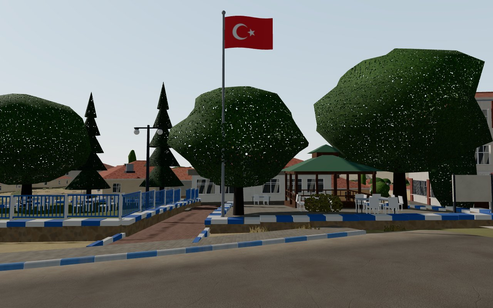
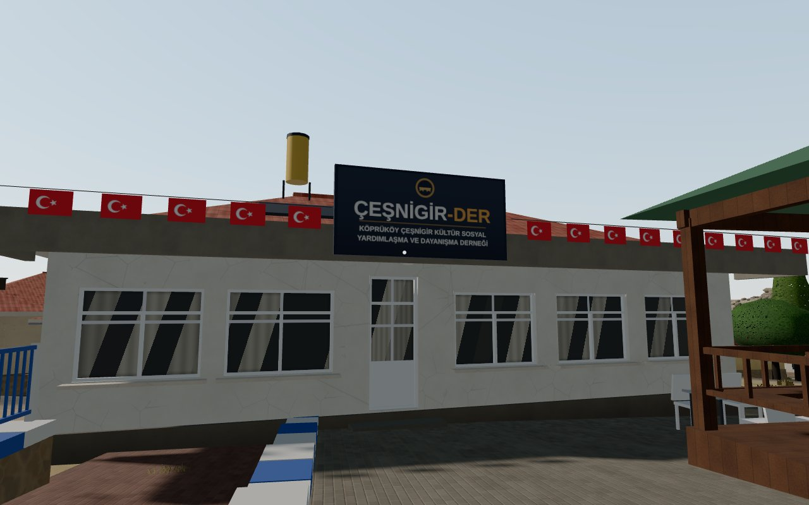
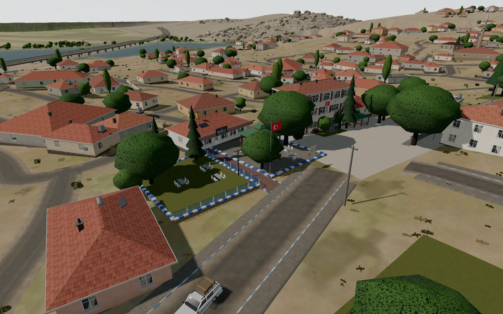
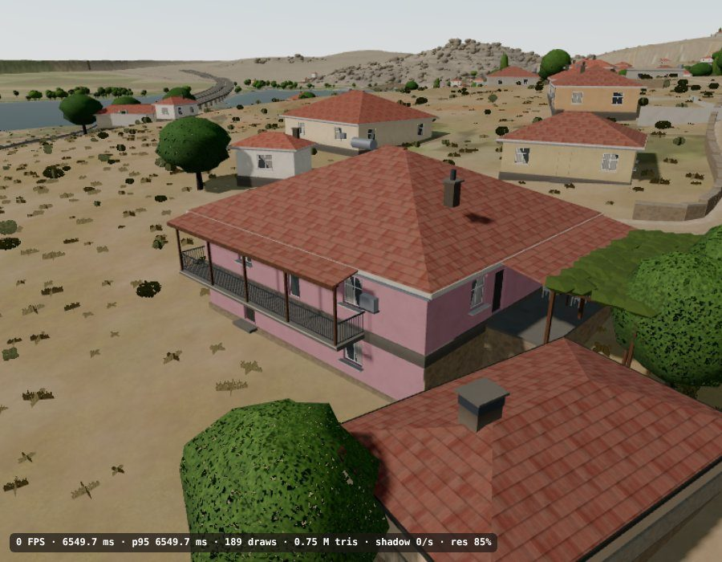
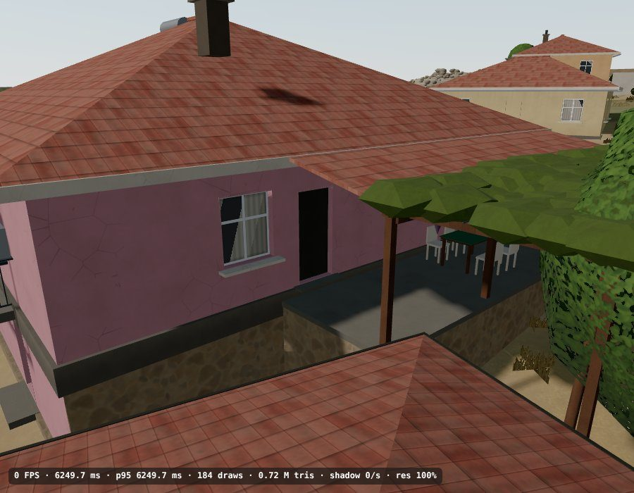
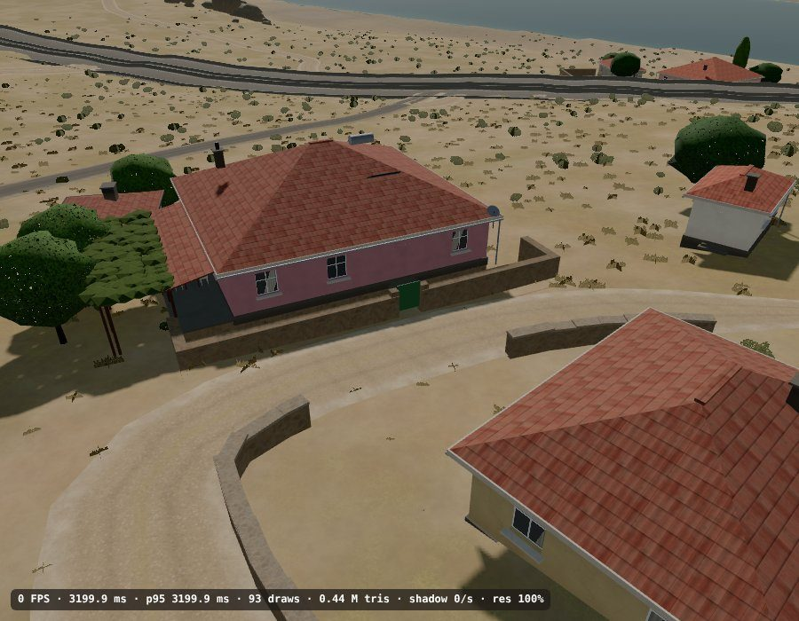
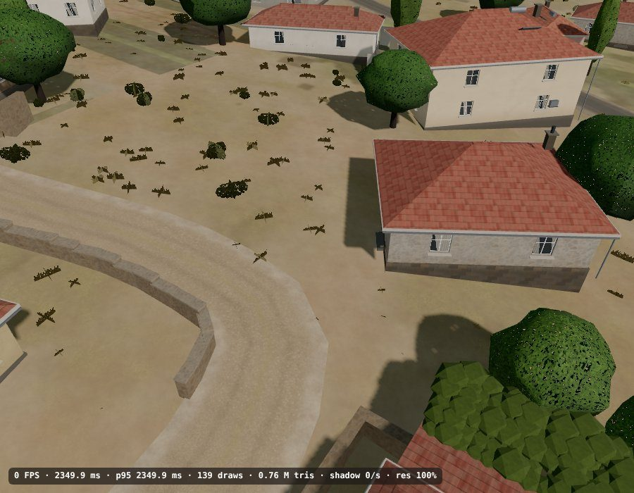
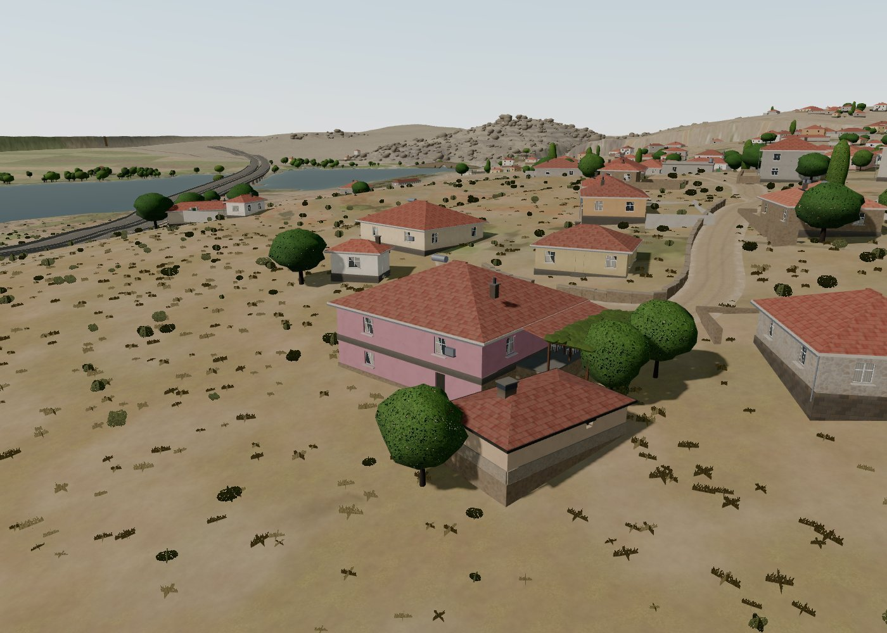
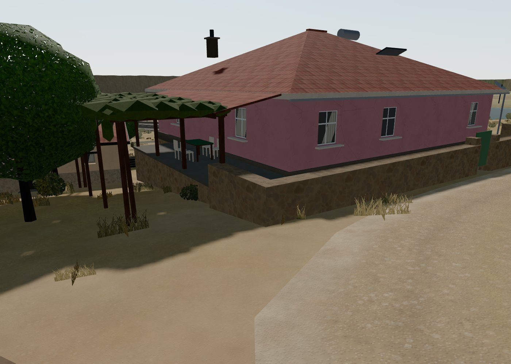

# Köprüköy 3D — realism notes

Two passes so far: **v0.7 "materials"** (surfaces only, nothing moved) and **v0.8 "square and mosque"**
(the old municipality square and the mosque rebuilt from the Street View photographs in `docs/reference/`). Everything is applied at load time in the browser; `model4.js` / `data4.js` /
`model/koprukoy.glb` are still the v0.6 files. Terrain (SRTM 30 m), the reservoir at 724 m, the
Çeşnigir Bridge body, D.260 and the roads outside the village are unchanged.

## v1.3 — the dusty-rose house's yard (Nov 2026)

From the owner's screenshot of 11 Nov 2026 (a line and two crosses drawn on the Orbit view). The drawn line was cast
onto the terrain from a camera fitted to his view (house corners, tandır corner and the fruit tree as reference
points), so the fence follows it to within about a metre (`ROSE_YARD` in `src/village_layout.js`, `buildRoseYard` in
`src/village.js`):

- **Wire-mesh fence**: a low (1.0 m) galvanised chain-link fence on pipe posts with a top rail, from the south-west
  corner of the dusty-rose house round the open ground on its south side to the tandır by the fruit tree. The mesh is
  a transparent diamond texture, so it reads as wire up close and as a faint grey veil from afar, and casts no
  solid shadow.
- **First cross**: a wooden garden table with four white plastic chairs.
- **Second cross**: a blue pipe A-frame swing with a plank seat and a red plastic seat on chains.
- **Donkey**: beside the swing, a small mouse-grey Anatolian donkey to ride on — pale muzzle and belly, dark
  mane, ear tips and tail tuft, a leather halter, and a red kilim saddle cloth under a leather pad, held by a girth.

No random draws, so the rest of the village is unchanged. Screenshots: `docs/screenshots/v1.3_rose_yard.jpg`
(the owner's view) and `docs/screenshots/v1.3_rose_yard_close.jpg`.

## v0.9.8 — ÇEŞNİGİR-DER (Nov 2026)

The owner's screenshot of the çardak plot south of the çarşı, with two photos taken at the opening of the
association: the "small office building among the trees" west of the plot is the **ÇEŞNİGİR-DER** building
(Köprüköy Çeşnigir Kültür Sosyal Yardımlaşma ve Dayanışma Derneği). `OWNER_FIX` / `DER_SITE` / `carsiSites` in
`src/village_layout.js`, `buildDernek` / `buildDer` / `buildPlot` in `src/village.js`, materials in
`src/village_materials.js`.

- **The building** (was the generic house at (225.3, 154.6), now (226.2, 150.8), moved 4 m north so the çardak stands
  in front of its north half and the walkway reaches its south half, as in the photos): single storey, pale grey
  render, the long front faces east to the çardak and the main road — two big white PVC windows, the glazed door,
  three more windows, each with transom and mullion — under a flat concrete canopy with a grey fascia and a lamp
  by the door. Over the door the navy name board (gold emblem, "ÇEŞNİGİR-DER", "KÖPRÜKÖY ÇEŞNİGİR KÜLTÜR SOSYAL /
  YARDIMLAŞMA VE DAYANIŞMA DERNEĞİ"), a string of small Turkish flags along the front, red tile hip roof with a
  yellow solar water heater and a chimney.
- **Forecourt** (the old raised çardak plot, now reaching the building): grey interlocking pavers instead of the
  lawn, low wall with blue-white kerb stones on the lane and road sides, open to the building; the çardak moved
  7 m west, close in front of the building; grey folding tables with white plastic chairs; the notice board at the
  corner by the lane; a big mulberry north of the çardak and a smaller one by the walkway.
- **Walkway** from the main road to the building between the forecourt and the garden: pale red pavers, blue-white
  kerbs at the road; the flag pole with a big Turkish flag on its right, a twin-headed street lamp on its left.
- **Garden terrace** (the small green south of the plot): raised lawn on a rubble wall with blue-white kerb stones,
  a blue railing with white posts along the walkway and the road (steps at an opening), tables and chairs, two
  spruces and a mulberry. The green's nine random draws are still made, so the rest of the village is unchanged.

Not modelled (transient in the photos): the opening's flower wreaths and the extra chairs on the street.

## v1.2 — balcony, entrance and two walls (11 Nov 2026)

Corrections from the owner's four screenshots of the same corner (`OWNER_FIX` and `STONE_WALLS` in
`src/village_layout.js`; `buildPorch` and the owner's doors in `src/village.js`):

- **Dusty-rose house, south side:** a covered balcony on the main floor over the lower storey, along the west four
  fifths of the side — a cantilevered concrete slab, an iron railing on the front and both ends, the roof carried
  out over it on wooden posts as on the east terrace, and a glazed door onto it between the two windows.
- **Dusty-rose house, entrance:** the entrance door is on the east side, opening onto the terrace at its south end
  (next to the free part of the wall with the window), with a stone threshold.
- **Stone wall along the lane:** no longer runs on from the bend to the cream house's gate, in front of the
  dusty-rose house's gate; the short piece west of the cream house's gate stays.
- **House at (117.6, 340.6):** its garden wall (the L-shaped piece towards the bend) is removed. Its random draws are
  still taken, so its colours, chimney and trees and every other house stay as they were.

## v0.9.7 — the owner's houses by the lake road (Nov 2026)

Corrections from the owner's screenshot of the lane north-west of the big cemetery, above the D.260 lake road
(`OWNER_FIX` and `STONE_WALLS` in `src/village_layout.js`, builders in `src/village.js`):

- **Tandır house** (101.4, 359.6): the small building in front is the village bake-house with the bread oven, not
  a dwelling — one low room, fieldstone base course under mud-plastered (adobe) walls, plank door with a timber
  lintel, one small window and a high vent, a wide soot-blackened smoke chimney, a low tile roof on wooden eaves
  and firewood stacked against the side wall.
- **Dusty-rose house** (88.6, 350.0): soft red-magenta natural render (`Duvar_Gul`). The ground falls about one
  storey to the west, so the downhill side shows a full lower storey (windows where the ground is low enough, a
  door on the lowest side, a floor band between the storeys); the east side, where the ground stays high, reads
  as a single storey over a rubble plinth. On that east side the roof runs on over a stone-faced terrace with a
  table and four white plastic chairs, a grapevine (asma) pergola in front of it, then the trees. The terrace
  leaves the south end of the side free, where the tandır stands.
- **Back house** (60.0, 319.4): single storey instead of two.
- **Stone wall**: a dry-stone wall along the lane on its north / west side, from the cream house round the bend
  and up the hill (with an opening at the cream house's gate), replacing that house's wire fence. It blocks
  walking and bullets like the buildings.

Every other house keeps its random colours and details: a corrected house is first built "dry" as generated,
recording its random draws, and the corrected version replays them (same roof / wall colour, chimney, trees) —
a pixel diff of a 600 m overview away from these houses is unchanged.

## v0.9.6 — Köprüköy Arena (Nov 2026)

The owner asked for a game version "like the walk and fly functions": a Counter-Strike-style fight against bots,
then for CS 1.5-quality weapons and livelier, armed, realistically roaming bots. `src/game.js`, entered with the
**Game** button; it reuses the walk controls, the collision data and the minimap.

- **Weapons** (CS 1.5 numbers, roughly): AK-47 (36 dmg, 10/s, climbing spread), M4A1 (33, 11/s), MP5 Navy (26,
  13.3/s), AWP (115, bolt action, right-mouse scope with 14° FOV, hopeless unscoped), Desert Eagle (54, 7 rounds,
  semi-automatic), knife. Primary chosen in Settings; 1 / 2 / 3, Q, wheel switch with a lower-and-raise animation,
  R reloads, magazines and reserve per weapon, camera recoil (the AK climbs), spread that grows while firing and
  while moving, headshots × 4, damage falloff with distance. Low-poly view models (receiver, handguard, curved or
  straight magazine, stock, sights, scope tube, muzzle brake), muzzle flash sprite, tracers, dust on walls, blood
  puffs on hits, synthesised per-weapon sounds.
- **Bots**: figures with vest, scarf, mask, boots and the same rifle models held in both hands (lowered on patrol,
  levelled when aiming; crouch pose at mid range sometimes). Each has its own speed, reaction time (0.3–0.7 s) and
  weapon (AK / M4 / MP5 / Deagle). They **roam the real road network**: `village_layout` lanes are turned into a graph
  of lanes and junctions; a bot walks a lane a little off the centreline, at a junction picks another lane at random
  (dead ends turn it round), stops now and then to look around. Perception: line of sight checked 4–5 times a second
  (terrain + 5.5 m building boxes, 120 m); they also hear gunfire (90 m, AWP 160 m) and turn towards shots that hit
  them. Combat: chase with run-and-gun sprints and aiming stops, strafe and crouch at 12–32 m, back off under 12 m,
  bursts whose length depends on the weapon, magazines that run out → fall back and reload, flee for cover under
  40 hp, hit chance from weapon accuracy × difficulty × distance, lower when either side moves, tracers and
  near-miss whizzes. 100 hp, headshots kill; they fall over and respawn out of sight after 6 s.
- Settings: 4 / 8 / 12 / 25 / 50 / 100 bots (every rigid part of a bot is baked into one vertex-coloured mesh, 7 draw
  calls per bot; bots farther than 180 m think ten times a second; shadows only up to 12 bots), primary weapon, Easy / Normal / Hard (bot accuracy × 0.6 / 1 / 1.5). Rounds of 5
  minutes, kills : deaths and a kill feed, Enter starts a new round; touch: joystick + FIRE / R / WPN buttons.
  Minimap shows bots only within 60 m.

## v0.9.5 — the village as Street View shows it (Nov 2026)

The owner asked for the model to look like the real place, Street View being the measure: the houses were too
big ("2–3 storeys with lots of windows are rare here"), the roads tangled, several structures not real. Checked
against all 86 panoramas in `docs/reference/streetview/` and the Google Maps building layer
(`docs/survey/gmap_layer_classes.png`); renders from the same points and headings were compared frame by frame
(`tools/shoot_pw.mjs`, a Playwright harness that serves the repo with a local three.js).

Causes: the v0.9 roof detector fused neighbouring roofs and yards into 25–50 m rectangles (104 footprints over
250 m²); the storey rule made a third of the village two storeys; `buildHouse` put a window every 3.1 m, so a 20 m
wall got six per floor and read as an apartment block; 143 footprints ran into the road ribbons; the v0.6 GLB
scatters granite boulders over the streets; all 316 lanes were drawn as 4 m concrete with hard edges.

The data corrections are `tools/v095_fix.py` (run once on the v0.9.4 data, like `gmap_fix.py`):

- **Footprints.** Where the Google building layer shows two or more buildings inside one model rectangle, the
  rectangle is replaced by those footprints (19 cases); where it shows one much smaller building the rectangle
  shrinks to it (5); the remaining rectangles longer than 24 m become a house of 10–14 m and a lower barn / annex
  with a gap between (35) — the barns and sheds next to houses in Street View 07, 52, 64. 679 → 734 buildings.
- **Storeys.** Without a Street View override a house is single storey unless compact (85–210 m², aspect < 1.8,
  tile roof) and picked by a stable position hash; and since every notable two-storey house seen in the panoramas
  already has an override, an unconfirmed two-storey house within 55 m of a panorama point becomes single storey
  (46 cases — the renders of SV02, 16, 17 and 34 showed two-storey blocks where the panorama has one-storey
  houses). 119 two-storey buildings of 734 (was 225 of 679), the proportion seen along the main road and the
  mahalle lanes. Long single-storey halls get a sheet roof at times. Street View overrides (110 buildings with
  wall / fence / kind data) are untouched.
- **Off the roads.** 134 footprints moved away from the road ribbon (≤ 3.5 m), 48 also shrunk on the road side.
- **Roads.** Centrelines simplified (Douglas–Peucker 1.0 m) and despiked (turns > 60° between segments < 7 m),
  dead-end stubs under 12 m removed. **Snapped to the satellite image** (`tools/sat_roads.py`): the owner noticed
  that the Google road layer the network was traced from is generalised — it runs 10–20 m off the real lane in the
  mahalles, cuts across yards and the corner of the football pitch, and shows a few lanes that are not there. The
  0.3 m mosaic (`docs/survey/satellite_mosaic_0.3m_small.jpg`, georeferenced on the main roads) gives a road
  evidence map (pale, low-saturation ground above its 9 m neighbourhood, not green, never inside a building
  footprint or the pitch, averaged along the road direction over ±12 m so roofs and bright yards do not count);
  each centreline is re-fitted within ±16.5 m by dynamic programming (strongest evidence, fewest bends, a prior to
  stay) and accepted only when clearly better than the traced line. 274 roads moved (4.3 m on average), 113 kept,
  82 outside the mosaic left as traced, 3 lanes with no visible track removed, 2 trimmed; shared endpoints move
  together and T-junctions are re-projected. `docs/survey/v0.9.5_roads_snapped_to_satellite.jpg`: blue = traced,
  yellow = snapped. Surfaces follow the panoramas: only the main road and the streets within
  ~150 m of the çarşı (and the brick-paved lanes by Yeni Cami) stay asphalt / paved; 342 mahalle lanes and the
  outer secondary roads are compacted earth / gravel with grass verges (Street View 07, 08, 29, 44, 54, 58, 62,
  66, 70, 96). Village asphalt is pale and dusty (02, 15, 17), not dark.

Rendering (`src/village.js`, `village_layout.js`, `village_materials.js`, `terrain.js`):

- windows: 2–3 on a 10–12 m street front, at most 4 on a long one, 1–2 on side walls, blank stretches on long
  walls (03, 36, 57, 60); floor-to-floor 2.8 m; barns / annexes 2.6 m high with small openings, no balcony, no
  garden wall;
- junctions and ends: each ribbon runs on past its end by the other road's half width so the carriageways overlap
  instead of stopping short of each other; endpoints within 7 m of the road they lead to are joined to it in the
  data; a lane that ends in the open tapers out over its last 10 m; a utility pole that would stand on a crossing
  road steps a few metres aside instead of breaking the line of cables; the road-clearance nudge keeps a step only
  when it reduces the intrusion (a house between two lanes used to be pushed off one straight onto the other);
- roads lie on the ground: the per-road stagger that separates overlapping ribbons at junctions was index × 3 mm and
  had grown to 1.4 m over 467 roads, so the lanes ran on raised causeways; it is now at most 3 cm on a 6–12 cm lift,
  and a lane is told from the ground by its paler surface alone (owner's request);
- houses on slopes: the floor is level with the ground on the street side and the plinth takes the drop on the
  downhill side; only a plinth over 2.6 m cuts the house into the slope (the earlier mid-slope floor left houses
  on the uphill side of a lane looking buried in the road);
- `pruneRocks`: the merged GLB rock mesh is split into boulders (connected components); the 144 boulders on a road
  ribbon, in a yard or within 18 m of a house are dropped (56/57: a plastered house and an ashlar garden wall where
  the model had a 6 m boulder; 62–69, 83, 96/97: boulders between the houses of the E and N mahalles). The granite
  ridge beyond the last houses stays (07, 08, 58);
- rendered garden walls are whitewashed / grey block (06, 09, 31, 44, 88) instead of the GLB's brown;
- the terrain inside the built area is weedy spring grass between the houses (every April panorama), while the
  baked macro texture stays a dry late-summer image outside it.

Screenshots: `docs/screenshots/v0.9.5_*` — overview, top-down, the salmon and lilac two-storey houses of the v0.9
screenshots in their new surroundings, an E lane without boulders, the main road, an E earth road, and three
model-vs-Street-View comparison sheets (SV38–40, 59–61, 86–88); `docs/survey/v0.9.5_plan_over_google_layer.png` is
the corrected plan over the Google building / road layer (red two-storey, yellow single, cyan barns, pink overrides).

Not resolved: the Google Maps link the owner sent (maps.app.goo.gl) could not be opened from this environment, so
its uploaded photos were not used; storey counts away from Street View coverage remain estimates.

## v0.9.4 — checked against the Google Maps map layer (Nov 2026)

The owner pointed at the area south of Keskin Köprü İlkokulu: in reality it is all cemetery, with only a small
workshop (two long buildings) at its lower end — the model had houses and roads all over it. Cause: the v0.9 roof
detector took grave clusters, bushes and bare red ground for roofs, and the road tracer turned the lane markings of
the D.260 on the map into a ladder of short 9 m "roads".

Method: the Google Maps map layer (lyrs=m, z18, 13 × 19 tiles) was fetched in the browser and reduced to three classes
(road / building footprint / rest), `docs/survey/gmap_layer_classes.png` (0.92 m/px, origin tile 155414/99633). It
lies on the satellite image to within a metre (`docs/screenshots/v0.9.4_google_layer_over_satellite.png`). Every road
centreline and every building of `src/village_data.js` was tested against it; the 188 buildings with no Google
footprint within 4 m were checked one by one on z19 satellite thumbnails (Google's footprint layer misses many real
houses, so it was not used blindly). The corrections live in `tools/gmap_fix.json` and are applied to the v0.9.2 data
by `tools/gmap_fix.py`.

- **Cemetery** (`SITES.cemeteries`, new polygon form in `buildCemeteryPoly`): one polygon between the top road, the
  frontage road along the D.260, the curved road and the school road — scattered headstones with slabs, loosely in
  rows and clusters, junipers / pines / mulberries, a low rubble wall on the north and west edges — plus the dense
  grave strip on its east side. The two rectangular walled cemeteries are gone.
- **Ekinoğulları Demir Doğrama**: the "big two-storey house" was the first of two long single-storey workshops; both
  are now on their Google footprints (32.5 × 12.8 m and 26.5 × 10.6 m).
- **Buildings**: 124 false roofs removed (bare ground, grave clusters, pools, tarps, garden plots, concrete pads and
  7 on the D.260 carriageway itself); buildings with Street View overrides were kept even without a footprint (the
  roofless concrete frame etc.). 71 Google footprints that had no building were added (single storey, two storeys
  when compact and 125–300 m², sheet roof above 300 m²); nothing added near the mosque, the çarşı or Yeni Cami.
- **D.260**: the GLB viaduct stopped at (166, 576) and a single 9 m ribbon ran down the frontage road into a tangle of
  ~40 short pieces at the junction. Now both carriageways (8 m each, 12 m apart) continue along the Google band to the
  terrain edge; the curved road crosses it once (`d260x_crossing`). Village roads that had been labelled "D.260
  extension" got their real class (school road 6.5 m, junction roads 7 m, the curved road 8 m).
- **Roads**: 9 dead-end stubs and junction curls not on the map removed, one missing lane (`local_gm1`, the loop north of the cemetery)
  added. After the fix every road is on the map layer and every map-layer road inside the model area has a road.

## v0.9.3 — the old stone building by Yeni Cami (Nov 2026)

The owner pointed out the abandoned historic stone building just north-west of Köprü Köyü Yeni Cami (his satellite
screenshot + a Street View frame); it was missing. Placed from his 0.2 m/px satellite crop relative to the model roads
(narrow lane on its east side, the wider road to the south-west): centre (175.5, -105.5) model, 12.6 × 10.4 m,
yaw -0.316. Built by `buildStoneRuin` (`src/village.js`): 0.6 m fieldstone walls extruded with round-arched openings
(3 windows on the long sides, 2 on the short ones, an arched doorway on the unseen north side), cut-limestone arch
surrounds with keystones and sills, alternating limestone quoins, a mud-plastered base band, a stone cornice, a low
hipped roof of rusted corrugated sheet on timber eaves with two slipped sheets; most windows half or fully blocked
with loose rubble, the rest show the dark empty hall. A pine N and a mulberry at the NE corner (satellite crowns).
A fused 21 × 10 m roof trace on the open lot to its west (not in the current satellite photo) was dropped —
`tools/sv_overrides.json` now supports `"remove": true`.

Note: Street View 20/21 (`NOTES.md`) had read this stone building as the Yeni Cami prayer hall; the real mosque is
the tile-roofed building under the Google pin, south-east of it.

## v0.9.2 — the çarşı (Nov 2026)

The owner reported that the Atatürk statue in front of the old municipality / Güvendioğlu Market had disappeared,
and asked for the çarşı to match the real place exactly. Cause: v0.9 moved the municipality to its true position
(photo-01 anchor at the market junction) but the statue, the square and the çardak kept their hard-coded v0.8
coordinates (~(40, 50)), about 200 m west; in addition the traced road network ran a 4 m lane straight across the
square and nudged the municipality and the market (6.7 m) off their footprints.

Sources: `docs/reference/01` (satellite, 0.25 m/px), `02` and `05` (Street View, Apr 2026), SV01–03 notes.

- **Measured footprints, no nudging** (`CARSI_FIX` in `src/village_layout.js`): municipality 17.6 × 7.6 m walls
  (19 × 9 m tile roof in photo 01, rotated ~5°); Güvendioğlu Market 10.4 × 7.8 m, shop floor at street level on
  the west, dug into the slope behind; the kahve single-storey, tile hip roof, long axis N–S, opening onto the square.
- **Everything on the square is placed in the municipality's façade frame** (`carsiSites`: s = metres from the
  south end along the east façade, out = metres in front), so it can never drift away from the building again:
  statue at s 9.0 / out 3.3 (in front of the second bay), grass bed with a concrete kerb, two flag poles behind it
  (Turkish flag on the southern one), red shrub and a young tree on the left, a small juniper and the tall spruce
  on the right, a big juniper at the south-east corner by the lane, the kahve's green-roofed kiosk with tables and
  red chairs at the north end, big trees in front of the kahve, the old tree on the market pavement.
- **Statue**: bronze (dark olive patina) standing figure in a long greatcoat, arms down, ~3 m, on a light grey
  granite pedestal (2.16 m incl. two concrete steps) with a dark plaque on the front.
- **Municipality façade** after 02/05: five wide bays per long side with ribbon windows of three panes, red-brown
  pilasters, tall whitewashed spandrel bands between the floors, white iron grilles on the ground floor, the door
  and a small window in the southern bay under the "T.C. KÖPRÜ BELEDİYESİ" board (canvas texture), three chimneys.
- **Square and roads**: the open area is one pale, dusty gravel surface (`square` material lightened); the traced
  lane `local_260` is re-drawn along the east side of the square (6.5 m, kerb + pavement only on the market side,
  no asphalt drawn on the square itself), `main_284` removed, the lane west (`local_283`) runs along the
  municipality's south wall (SV03). The square is added to the collision / road samples (walkable, no grass on it).
- **Raised park south of the lane** (photo 02 left): rubble wall topped with blue and white painted kerb stones,
  lawn ~0.7 m above the square, big square wooden çardak (eight posts, railing, benches, two-tier green roof with
  a lantern), notice board, two big trees.
- Collision boxes for the statue, the kiosk and the çardak; `#centre-only` uses the same çarşı. The
  "Village centre" viewpoint now looks at the square.

Not modelled (transient in the photos): parked cars and vans, the greengrocer's crates.

## v0.9 — the whole village from Google Maps (Nov 2026)

Measure of realism, as the owner asked: Google Maps. Three sources, all captured from the browser and
georeferenced on the Çeşnigir Bridge place pin (39.5809021 N, 33.4292022 E == model `(-376.89, -277.44)`,
1 unit = 1 m, +x east, +z south):

| Source | Capture | Used for |
|---|---|---|
| Map layer (roads) | 12 tiles at z17 (0.60 m/px), stitched to `docs/survey/map_layer_mosaic_small.jpg` | the road network: colour mask → skeleton → graph → junction clustering → 521 centrelines |
| Satellite | 24 tiles at z18 (0.30 m/px), `docs/survey/satellite_mosaic_0.3m_small.jpg` | 722 roof rectangles (tile / dark-red / blue sheet / white / grey), the mosque compound, cemeteries, the football pitch |
| Street View (Apr 2026) | 28 panoramas (main road swept every ~30 m, both sides), `docs/reference/streetview/` with `NOTES.md` | storeys, roofs, wall types, kerbs, trees, the two minarets, the market, the school |

Scripts: `tools/trace_roads.py` → `tools/clean_roads.py` (map mosaic → `roads_clean.json`), `tools/trace_buildings.py`
(satellite mosaic → `buildings_traced.json`), `tools/build_village_data.py` (both → `src/village_data.js`).

**Georeference and the warp.** The v0.6 GLB has the Çeşnigir Bridge at its true position, but its D.260 viaduct
lies ~70 m north-east of the real alignment. Rather than move the viaduct, every traced coordinate is shifted by a
smooth vector (0 within 150 m of the bridge, the full `(+43.9, -54.6)` m beyond 500 m), so the shore road meets the
old bridge and the village roads meet the viaduct. The D.260 carriageways themselves stay as the GLB; the traced
road continues south-east of the viaduct's end as a 9 m asphalt ribbon.

**What changed**

- The hand-drawn v0.8 street network and the generated houses are gone. All roads are Google's: 26 "main" (the
  thick village road, 6.5 m asphalt with blue-white kerbs and utility poles), 119 secondary (5 m asphalt, kerbs),
  344 local concrete lanes (4 m), 11 dirt tracks outside the built area. Free ends within 32 m of the viaduct are
  snapped onto it.
- 722 buildings on their satellite footprints and orientations; storeys 2 when the roof is tile and >125 m² and
  compact; roof from the roof colour (tile/dark red → hip, blue → sheet metal, white/grey → flat). Garden walls:
  32 % rendered, 30 % dry-stone granite rubble (new material), 26 % wire fence.
- The photo-01 anchor (market junction) moved from `(55, 50)` to its true position `(258.1, 132.3)`, so the old
  municipality, the square with the Atatürk statue and the çardak are now where they really are; the Güvendioğlu
  Market is 2 storeys with a hip roof and the old tree in front (Street View 01).
- Mosque: **two** minarets at the north corners (satellite + Street View 05/12 — photo 06 cropped the second),
  compound enlarged to ~50 × 56 m with the grove in its western half and the lawn / picnic table / brick pavement
  between the west wall and the main road (Street View 04).
- Keskin Köprü İlkokulu as a 2-storey red-brown building; two walled cemeteries with headstones and pines; the
  football pitch; the real village extends ~150 m east of the terrain edge (x > 870) and is cut there.
- `#centre-only` restores the v0.8 behaviour (old roads and houses, only the square and the mosque rebuilt).

**Per-building Street View overrides** live in `tools/sv_overrides.json` (pin-frame position → storeys, wall colour, roof, fence type) and are matched to the nearest footprint by `build_village_data.py`; the cedar avenue east of the market is `SITES.treeRows`; `SITES.gardens` (tea garden S-W of the market, fenced green N), `SITES.minarets` (Köprü Köyü Yeni Cami: cut-stone hall + one minaret with a turquoise cap). Overrides can also *add* a footprint the roof detector missed (`add`), e.g. the unfinished block house at the north end.

**Still open**: storey counts away from Street View coverage are guesses; the lake shoreline (SRTM) still differs
from the satellite by tens of metres south of D.260; Fatih Camii (N-E) is still a plain house in the data; no sun / lighting work (owner's request).

## v0.8 — square and mosque (Nov 2026)

Scope, as decided by the owner: only the **old municipality square** and the **mosque** are rebuilt from the
photographs in `docs/reference/`. Roads, houses, trees and the bridge stay as in v0.7. The full
re-layout of the centre that was also built (connected street network traced from the satellite image,
~260 houses, kerbs, poles, bridge voussoirs) is kept in the code behind opt-in URL flags —
`#village` (whole centre) and `#bridge-detail` — but is not shown by default.

| Area | Now |
|---|---|
| Old municipality | "T.C. Köprü Belediyesi" opposite the market (footprint detected from its roof in the satellite image): 3 storeys, dirty whitewash with red-brown pilasters between wide window bays, horizontal bands, entrance canopy and steps, sign board, low-pitch tile roof with wide eaves, flag pole. Walls are façades with real window openings (reveals, sills). |
| Square | Stabilised-earth square east of the building; the Atatürk statue (bronze figure on a granite pedestal), two benches, a litter bin, mulberry trees and the green-roofed çardak. The two old houses on the site were removed. |
| Mosque | Rebuilt after `06` inside the old courtyard footprint: pale turquoise lime wash, two rows of recessed windows, drum with windows and a lead main dome, four lead corner domes, a three-domed son cemaat yeri on limestone columns, one slender limestone minaret with a single şerefe and a lead külah; red-plastered courtyard wall with concrete coping and iron gates, ablution fountain, pines and mulberries in the yard. The old two-minaret mosque is removed. |
| Labels | "Village mosque", "Small mosque (mescit)" and "Village centre" removed; in walk / car modes labels are hidden beyond 320 m. Viewpoints "Village centre" and "Mosque" added. |

Collision and the minimap follow (the two footprints replace the old ones in `data4` in memory).

Debug / opt-in switches in the URL hash: `#village` (full centre re-layout), `#bridge-detail`,
`#no-village`, plus the v0.7 ones (`#no-terrain`, `#no-bld`, `#no-road`, `#no-rock`, `#no-water`,
`#no-trees`, `#no-cover`). `#lite` = low quality.

### Files

- `src/village_layout.js` — footprints and sites (centre-only layout by default; the full satellite-traced layout and street generator are here too). No three.js.
- `src/village.js` — geometry: municipality, statue, çardak, square, mosque (and, with `#village`, roads, kerbs, houses).
- `src/props.js` — trees, benches, bins, poles. `src/geo.js` — geometry toolkit (façades with holes, roofs, ribbons, patches, per-material batching).
- `src/village_materials.js` — turquoise / red / whitewash plaster, lead, limestone, kerb paint, road shaders.
- `src/bridge.js` — voussoirs, string course, coping, cutwater caps (opt-in).
- `tools/trace_roofs.py` — roof detection in the satellite image; `tools/plan_check.mjs` — layout dump; `tools/screenshot.mjs` — headless render harness.
- `docs/screenshots/v0.8_*` — square with the municipality, mosque, and (from the full re-layout) overview, street, top-down, plan overlay.

### Still open

1. Roads still do not connect to each other and houses are not placed from imagery — the full re-layout
   exists (`#village`) but needs wider satellite captures and more Street View frames in
   `docs/reference/` before it reflects the real village outside the photographed block.
2. Building geometry elsewhere is still boxes; road edges, bridge voussoirs and tree variety are available
   only behind the flags above.
3. Lighting / atmosphere intentionally untouched (owner's request).

## v0.7 — materials pass

Goal of this pass: make the existing, surveyed model *look* like the place without moving anything.

| Area | Before | Now |
|---|---|---|
| Terrain | one baked 2048² satellite-style texture, flat colour | `src/terrain.js`: the satellite-derived map is kept as the *macro* layer and modulates five detail layers blended by slope, elevation, shoreline distance and noise: dry soil, dry steppe grass, gravel, wet shoreline sediment, weathered rock on steep faces. |
| Buildings | flat Blender colours, no UVs | `src/buildings.js`: world-space triplanar lime plaster with per-house tint/fade jitter; ~14 % rubble stone, ~10 % bare concrete; rain-splash band, eaves streaks, grime. Clay-tile roofs whose courses follow the slope; corrugated metal variant. Windows: frames, mullions and reveals in the shader, dark / curtained / lit interiors. |
| Roads | uniform light grey | `src/surfaces.js`: worn asphalt, compacted earth, concrete with slab joints, paving, kerbs. |
| Çeşnigir Bridge | flat beige | Seljuk-type dressed ashlar, per-block tone variation, soot streaks, damp band with algae above the water line. |
| Granite outcrops | smooth grey domes | roughened on the CPU with world-space noise; pale granite with speckle, iron staining, lichen. |
| Water | opaque saturated cyan | depth-aware reservoir (turbid shallows, dark deep water), two ripple scales, Fresnel. |
| Trees | smooth blobs | world-space leaf-cluster cut-out (porous canopies, dappled shadows), bark on trunks. |
| Ground cover | none | `src/vegetation.js`: ~48 000 grass tufts and ~9 000 shrubs, instanced, rule-based scatter. |
| Textures | — | `tools/gen_textures.py`: 15 seamless PBR sets, 8 MB total (`tex/`). |
| Tone mapping | ACES | AgX. |

Quality tiers: `QUALITY` in `index.html` — 2 desktop, 1 touch devices, 0 for `#lite`.

### v0.9.1 — SW mahalle Street View eşlemesi
- 6 yeni panorama (SV34–39, `docs/reference/streetview/`): (4.8,217), (139,221), (52,204) pin-çerçeve noktaları, yola dik iki yön.
- Bina bazlı düzeltmeler (`tools/sv_overrides.json`): pergolalı beyaz ev + moloz istinat duvarı, kırmızı tuğla 2 kat + sac çit, çatısız betonarme karkas (uydudan tespit edilemediği için `add` ile eklendi, yeni `Duvar_Beton` malzemesi), krem/okr sıva 1 kat evler, açık yeşil sıva ev + kaldırım ağaçları.
- (149.6,264.2) ve (15.2,268.4) noktalarında Street View yok; bu iki sokak uydu + harita katmanından kalıyor.
- Batı ana yol + merkez-batı sokaklar (SV40–49): krem/beyaz 1 kat evler + blok duvar ve mavi kapı, beyaz 2 kat balkonlu + güneş ısıtıcılı evler, eski gri sıvalı 2 kat (89,90), bordo boyalı 1 kat (120,-4), hardal rengi 2 kat (180,142). SV15'teki "harabe dükkân sırası" override'ı yanlış binaya yapışıyordu → (203,135)'e `add` olarak taşındı. (193,-3)'te Street View yok.
- Doğu yakası (SV50–75, Köprüköy Köyü Yolu + güney/güneydoğu sokaklar): 26 panorama, 30 bina düzeltmesi — tuğla 2 katlar, somon/açık mavi 2 katlar, kerpiç ahırlar, moloz harabe, konteyner, sac sundurma; ağaç altında kalıp uydudan tespit edilemeyen 3 bina `add` ile eklendi. Not: Street View URL API'si hızlı ardışık isteklerde boş ("0a") dönüyor — nokta başına ≥20 s ara gerekiyor.
- Güney ana yol (SV76/77): köy parkı — çim, oyun alanı (kaydırak + salıncak, `buildPlayground`), banklar — `gardens[].play` ile eklendi (375,383 pin).
- Güney / okul bölgesi (SV78–93): 16 panorama, 21 düzeltme — sarı/leylak/beyaz 2 katlar, kerpiç kırmızı ev, pompa kulübesi, beyaz çadır hangar, uzun bej salon; `Duvar_Lila` malzemesi eklendi; uydudan kaçan 4 bina `add` ile eklendi.
- Kuzey (SV94–99): Yeni Cami yanı moloz ahır, gri sundurma, kuzey sırtı tuğla/briket evler, plastik örtülü saman tünelleri. (396,-34), (300,-94), (426,-112), (-17,-30) noktalarında Street View yok (kuzeydoğu/Fatih Camii çevresi ve batı uç kapsama dışı).
- Yamaç evleri: taban kotu artık en yüksek köşe yerine düşüşün ortasına oturuyor (kazı-dolgu), 1.9 m'yi aşan kaideler moloz istinat duvarı malzemesiyle çiziliyor — SV78/86/99'daki görünüm.
